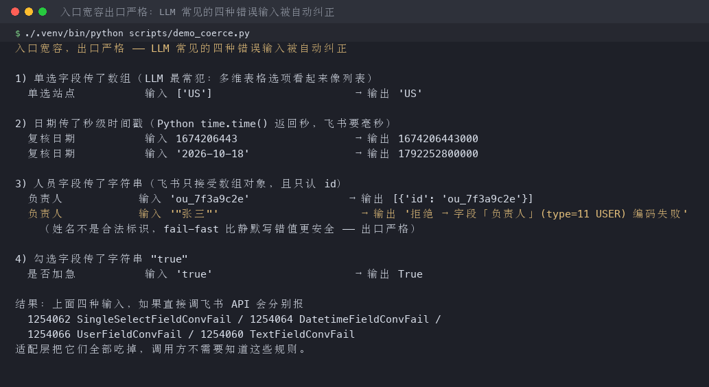
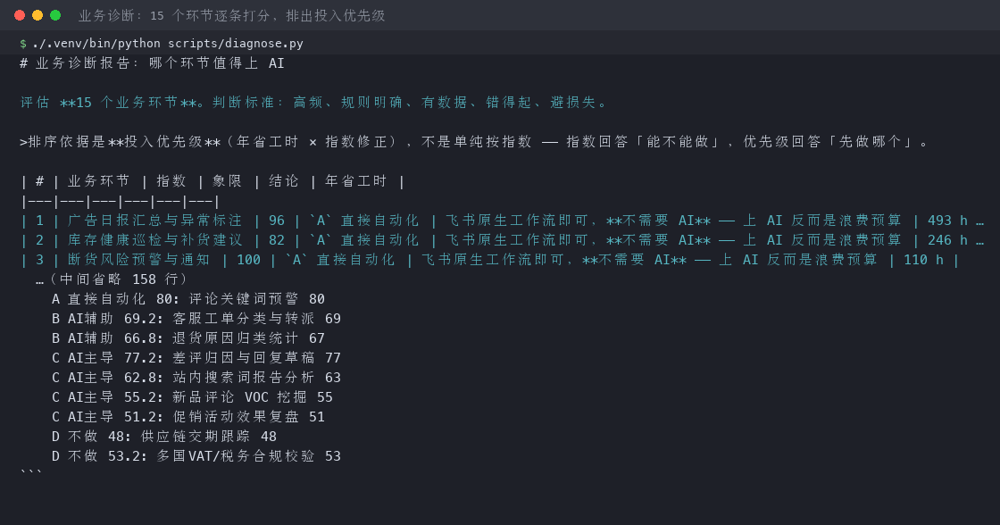
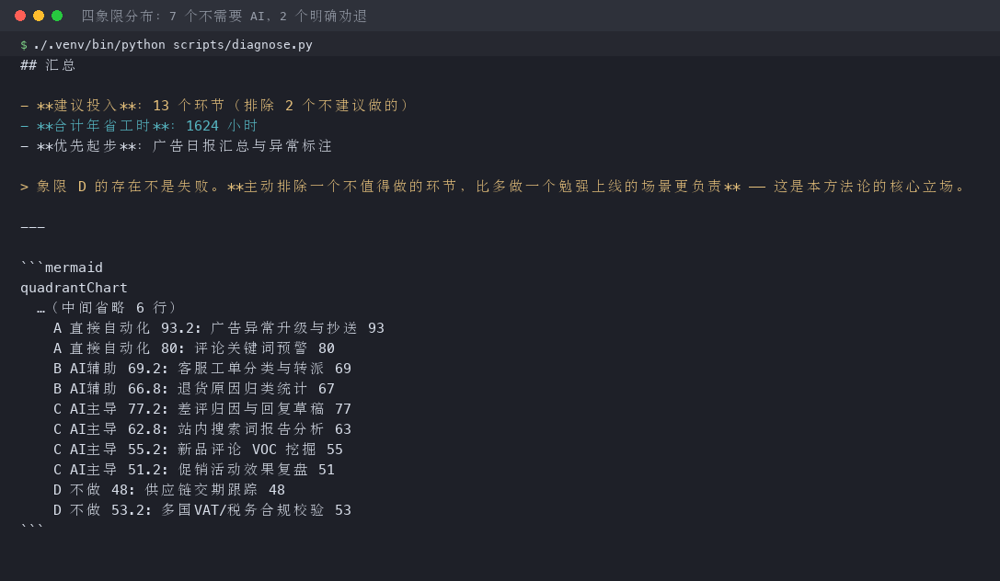
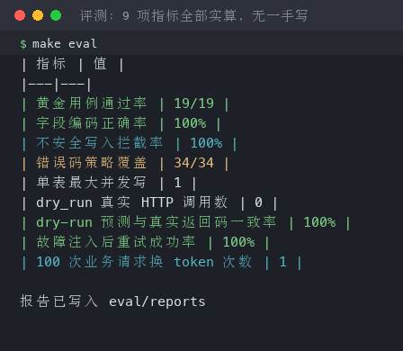
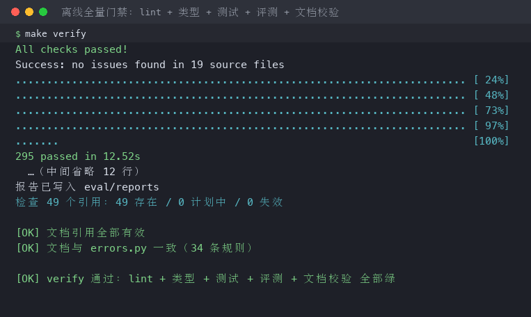
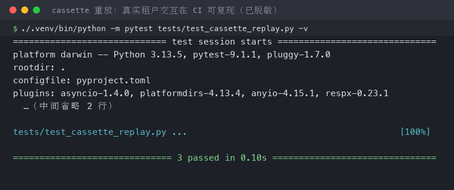
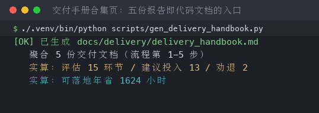
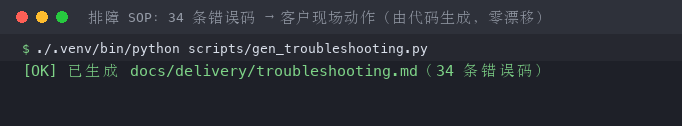

# BasePilot

> 面向企业交付的**飞书多维表格 MCP Server** —— 用 MCP 工具把多维表格变成
> Claude Code / Cursor 可**安全读写**的业务台账。

[](https://github.com/Peterwong666/basepilot/actions/workflows/ci.yml)
[](https://www.python.org/)
[](LICENSE)

**[English](#english-readme) · 简体中文**

---

## 这是什么

中小企业已经在用飞书多维表格承载业务台账（库存、广告、差评跟进），
数据靠人工从 Seller Central / 广告后台导 CSV 再粘贴进去，每天 1-2 小时。
公司想上 AI，但第一件事就卡住了：

| 卡点 | 飞书返回 | 根因 |
|---|---|---|
| AI 给人员字段传了字符串 | `1254066` UserFieldConvFail | 必须是 `[{"id": "ou_xxx"}]` 数组对象 |
| AI 给日期字段传了秒级时间戳 | `1254064` DatetimeFieldConvFail | 必须是 **13 位毫秒**，差 1000 倍 |
| AI 给单选字段传了数组 | `1254062` SingleSelectFieldConvFail | 必须是**字符串**，不是数组 |
| AI 写得稍快一点 | `1254291` Write conflict | **同一数据表不支持并发写**，官方建议加 0.5-1秒延迟 |

**这不是技术选型问题，是没有人把多维表格的真实约束包一层。**
业务等不了，AI 落地就停在这里 —— 这是很多「客户买过 AI 工具但没用起来」的真实原因。

BasePilot 就是那一层。

---

## 看图说话（全部为真实运行输出，非手绘）

### 1. 入口宽容，出口严格—— 适配层把 LLM 的错误输入吃掉

`scripts/demo_coerce.py` 把LLM 最常犯的四种错误喂给适配层，看它们被自动纠正：



### 2. 业务诊断：15 个环节逐条打分，明确劝退 2 个



四象限分布（7 个不需要 AI，4 个 AI 主导，2 个明确劝退）：



### 3. 评测：9 项指标全部实算，无一手写



### 4. 离线全量门禁：lint + 类型 + 测试 + 评测 + 文档校验



### 5. cassette 重放：真实租户交互在 CI 可复现（已脱敏）



### 6. 交付文档链：五份「报告即代码」自动生成



排障 SOP由 `errors.py` 自动生成，与代码零漂移：



> 全部截图由 `scripts/make_screenshots.py` 执行真实命令后渲染，不存在手绘图。
> 脚本内置「解释器污染」防护 —— 用错Python 环境会导致场景包静默降级，
> 生成数字错误的图，已加断言阻止出图。

---

## 架构

```
┌─ MCP 工具层 ──────────────────────────────────────────────┐
│  describe_table · create/update/delete · search            │
│  batch_upsert · dry_run_create · diagnose_scenarios        │
└────────────────────────┬───────────────────────────────────┘
                         │
┌─ 引擎五层 ────────────────────────────────────────────────┐
│  serialization.py  per-table 锁 + 0.5s 节流                │
│  client.py         串联调用链 · upsert_records             │
│  coerce.py         13 类编码器 + normalize_key 解码        │
│  ratelimit.py      分桶限流（write/search/list 独立）│
│  auth.py           token 缓存 + asyncio 单飞               │
└────────────────────────┬───────────────────────────────────┘
                         │
┌─ 横切三线 ────────────────────────────────────────────────┐
│  config.py飞书约束常量（每个数值标注官方出处）      │
│  errors.py       34 条错误码 → 客户现场动作               │
│  cassette.py     录制/重放 + 凭证与租户标识符脱敏           │
└────────────────────────┬───────────────────────────────────┘
                         │
              https://open.feishu.cn/open-apis
```

**分层原则**：不是把 API 包装成工具，而是把飞书的真实约束收敛到三层里。
工具层只表达业务意图（`batch_upsert`），约束由引擎层统一兜住 ——
否则同一条记录走不同入口会得到不同结果（见 ADR-004）。

---

## 三个适配层（核心）

不是把 API 包装成工具，而是**治理飞书的真实约束**。

### 1. 鉴权层 —— token 缓存 ✅

`tenant_access_token` 有效期 7200 秒。官方明确：**剩余有效期小于 30 分钟时返回新 token，
大于等于 30 分钟时返回原 token**。所以刷新窗口必须落在 `[0, 30min]` 区间内，
否则会拿到同一个 token，白白消耗配额。

实现：进程内缓存 + `asyncio.Lock` 单飞（并发下只换一次，其余复用）。

**实测指标：100 次业务请求 → 向飞书换 token 1 次。**
（`tests/test_auth.py::test_100_requests_fetch_token_once`，可复现）

### 2. 并发层 —— 单表写串行 ✅

官方错误码 `1254291` 的排查建议原文：「在接口与接口之间增加 **0.5 或 1 秒**的延迟」；
`1254607` 补充说明底层「基于版本维度的串行方式，**不支持并发**」。

实现：**per-`table_id` 的锁**（不是全局锁 —— 不同数据表之间仍可并行）+ 0.5s 请求节流，
主动规避 1254291 而不是撞上再重试。

**实测指标：200 次压测下，单表最大并发写 = 1，`1254291` 计数 = 0。**
（`tests/test_client.py::test_same_table_writes_are_serialized`，可复现）

### 3. 类型层 —— 字段编码适配 ✅

按 13 类字段自动编码为官方要求格式，并对**不可写字段 fail-fast**。
另有 `normalize_key()` 解码：API 读回的文本字段是富文本数组、URL 是对象，
upsert 唯一键提取必须归一化，否则「已存在」判为「不存在」导致重复创建
（详见 `docs/adr/006-read-write-schema-asymmetry.md`）。

| type | 字段 | 正确格式 | 常见错误 |
|---|---|---|---|
| 3 | SingleSelect | `str` | ❌ 传数组 |
| 4 | MultiSelect | `list[str]` | |
| 5 | DateTime | **13 位毫秒** | ❌ 传秒级 |
| 7 | Checkbox | `bool` | ❌ 传 `"true"` |
| 11 | User | `[{"id": "ou_xxx"}]` | ❌ 传字符串 |
| 15 | Url | `{"link": "...", "text": "..."}` | ❌ 只传字符串 |
| 17 | Attachment | `[{"file_token": "..."}]` | ❌ 传本地路径 |
| 18/21 | 关联字段 | `list[str]`（record_id） | |
| 19/20/1001-1005/3001 | 公式/查找引用/创建时间等 | **拒绝写入** | ❌ 尝试写系统字段 |

设计原则：**入口宽容，出口严格** —— 允许 LLM 传 ISO 日期、秒级时间戳、单元素数组，
适配层内部统一转成官方格式。**LLM 出错的空间由适配层吃掉，而不是把 1254064 抛给客户。**

**实测指标：19 条黄金用例，字段编码正确率 100%，不可写拦截率 100%。**
（`eval/runner.py` 实算，`make eval` 可复现）

---

## MCP 工具（8 个）

| 工具 | 作用 |
|---|---|
| `describe_table` | 读表结构与字段类型 |
| `create_records` / `update_records` / `delete_records` | 增 / 改 / 删（删除默认 dry-run） |
| `search_records` | 按条件检索 |
| `batch_upsert` | 按唯一键幂等 upsert（自动拆 create/update） |
| `dry_run_create` | **预演**：跑完整编码链路但零真实写请求 |
| `diagnose_scenarios` | 业务诊断：判断哪些环节值得上 AI |

接入 Claude Code：

```json
{
  "mcpServers": {
    "basepilot": {
      "command": "basepilot-mcp",
      "args": ["serve"],
      "env": {
        "BASEPILOT_APP_ID": "cli_xxx",
        "BASEPILOT_APP_SECRET": "xxx",
        "BASEPILOT_APP_TOKEN": "bascnxxx",
        "BASEPILOT_TABLE_INVENTORY": "tblxxx"
      }
    }
  }
}
```

---

## 远程模式（HTTP / SSE）

默认 `serve` 走 stdio，供 Claude Code / Cursor 本地接入 —— 凭证留在本机环境变量，
这是推荐用法。需要把 Server 部署到服务器、供多人或多客户端远程接入时，
用 HTTP 传输（FastMCP 4.x，streamable-http）：

```bash
basepilot-mcp serve --transport http --host 127.0.0.1 --port 8000
# 客户端接入 http://127.0.0.1:8000/mcp/

basepilot-mcp serve --transport sse --port 8000        # 旧版 SSE 协议，挂载 /sse/
basepilot-mcp serve --transport http --path /custom    # 自定义挂载路径
```

- `--host` 默认 `127.0.0.1`（仅本机）；`--port` 默认 8000；`--path` 默认用 FastMCP 内置路径。
- **鉴权注意**：MCP 层没有内置鉴权 —— 能连上端口就能调用全部写工具，
  等同于你的飞书 app 权限。**不要把端口直接绑 `0.0.0.0` 暴露公网**：
  请放内网，或在前面加带鉴权的反向代理（nginx / Caddy + Bearer Token / mTLS）。
- 飞书凭证只存在**服务端**环境变量（`BASEPILOT_APP_ID` / `BASEPILOT_APP_SECRET`），
  不经过客户端与网络传输。

---

## 当前进度

**全部模块已完成，已在真实飞书租户跑通全链路。** 每个指标都由代码实算
（`make eval`），未实测的不会写成已达成 —— 这是本项目的铁律。
`make verify` 离线全绿（**308 tests**，含门禁脚本自身 3 个测试）；`make live-smoke` 连真实飞书跑通
鉴权→建表→写入→读回→清理；跨境三表 `batch_upsert` 幂等（第一次全新增，
第二次全更新无重复）。

| 模块 | 状态 |
|---|---|
| 飞书约束常量（`config.py`） | ✅ 已完成，每个数值标注官方出处 |
| token 缓存（`auth.py`） | ✅ 已完成，100 请求换 1 次 token 已实测断言 |
| 错误码处置（`errors.py`） | ✅ 已完成，**34 条规则**，含客户现场指引 |
| 接口分桶限流（`ratelimit.py`） | ✅ 已完成 |
| 字段编码适配（`coerce.py`） | ✅ 已完成，13 类编码器 + `normalize_key` 解码 |
| 客户端与并发控制（`client.py` / `serialization.py`） | ✅ 已完成，200 压测单表并发=1 |
| MCP 工具层（**8 个工具**） | ✅ 已完成（FastMCP，stdio / HTTP / SSE 可跑） |
| 业务诊断打分器（`diagnosis.py`） | ✅ 已完成，15 场景四象限 |
| cassette 录制/重放（`cassette.py`） | ✅ 已完成，真实交互 CI 可重放 |
| 跨境三表场景包（`src/basepilot/scenarios/cross_border/__init__.py`） | ✅ 已完成，真实租户幂等验证 |
| 交付文档（playbook/training/troubleshooting/weekly_ops） | ✅ 已完成，排障 SOP 由代码生成 |

判断进度的方式：`basepilot-mcp doctor`（如实列出已实现项）。

---

## 快速开始

### 第 1 步：凭证从哪来

1. 登录 [飞书开放平台](https://open.feishu.cn/app) →「创建企业自建应用」，
   拿到 **App ID**（`cli_` 开头）与 **App Secret**
   （[官方指引](https://open.feishu.cn/document/home/develop-a-bot-in-5-minutes/create-an-app)）。
2. 在应用后台「权限管理」开通多维表格权限（`bitable:app`），然后创建版本并发布。
3. 把凭证配进环境变量，跑**凭证引导向导** —— 它会真实调飞书 OpenAPI
   验证凭证连通性、验证你的 `app_token` / `table_id` 可达，
   最后输出可直接粘贴的 `mcpServers` 配置（uvx 与本地开发两份）：

```bash
export BASEPILOT_APP_ID=cli_xxx
export BASEPILOT_APP_SECRET=xxx
basepilot-mcp init         # 三步引导：验证凭证 → 验证数据表 → 输出 mcpServers JSON
```

非交互环境（CI / 管道）里向导不会干等输入：检测到非 TTY 会打印
完整的环境变量配置指引后以退出码 2 退出。

### 第 2 步：跑起来

```bash
git clone https://github.com/Peterwong666/basepilot.git
cd basepilot
uv sync                    # 或 make setup

cp .env.example .env       # 填入你的飞书应用凭证（或直接沿用上面的 export）

make verify                # 离线全量校验：lint + 类型 + 测试 + 评测 + 文档校验
make eval                  # 实算评测指标（并发峰值/重试成功率/dry-run 一致率）
make live-smoke APP=<app_token> TBL=<table_id>   # 连真实飞书跑全链路
python scripts/seed_cross_border.py                # 跨境三表灌数（幂等，可重复）
make adoption APP=<app> TBL=<表ID> KEY=<唯一键>    # 上线后促活三指标，出周报
```

> 所有脚本都用项目自己的 venv 解释器。**用系统 Python 可能缺少 PyYAML 导致
> 场景包静默降级为fallback（4 条内置场景），跑出的数字是错的** ——
> `scripts/diagnose.py` 等已通过 `make verify` 的门禁检查，但请优先用 `make` / `uv run`。

---

## 安全设计

- **删除护栏**：`delete_records` 默认 `dry_run=true`，须显式 `confirm=true` 才真删 ——
  防 LLM 幻觉批量删库。
- **不可写字段拦截**：公式 / 查找引用 / 创建时间 / 自动编号等 13 类系统字段 **fail-fast 拒绝写入**，
  不允许静默写坏数据。
- **凭证隔离**：`.env` 已 gitignore；cassette 里app_id / app_token / table_id /
  record_id 全部替换为占位符（`cassette.redact_identifiers`）——
  这些不是密钥，但会暴露租户身份。
- **发布前门禁**：`tests/test_no_secrets_in_repo.py` 在 CI 里扫描仓库，
  检出真实租户标识符 / 泄露的 `.env` / 本机绝对路径即失败；失败信息只报位置不回显值。

---

## 非目标（Non-goals）

**主动划边界比假装覆盖更可信。** 本项目**不做**：

- ❌ 删除整个多维表格（Base）—— 不可逆，风险远高于收益
- ❌ 授予/变更权限 —— 应由表owner 在界面完成
- ❌ OAuth 授权流程 —— 定位是企业内部工具 + 开源交付包
- ❌ 直接发送飞书消息 —— 外部可见副作用应由上层决策
- ❌ 事件订阅（长连接）—— 需公网与连接数管理，且不解决当前核心痛点

---

## 与官方 lark-mcp 的关系

官方 `@larksuiteoapi/lark-mcp` 把飞书 API 直出为 MCP 工具，覆盖度更广（40+ 工具）。
本项目**不做覆盖度竞争**，做**交付可靠性**：

| 能力 | 官方 lark-mcp | BasePilot |
|---|---|---|
| 单表写串行 + 节流 | ✗ | ✓ |
| 字段类型预检（dry-run） | ✗ | ✓ |
| 不可写字段拦截 | ✗ | ✓ |
| 错误码分类处置 + 现场指引 | ✗ | ✓ |
| 幂等键重生成 | 部分 | ✓ |
| 离线录制回放测试 | ✗ | ✓ |
| 业务语义工具（CSV 同步 / 风险标注 / 差评闭环） | ✗ | ✓ |
| 客户交付手册 + 排障 SOP | ✗ | ✓ |

详见 `docs/adr/005-why-not-wrap-official-lark-mcp.md`。

---

## FDE 交付方法论五连（报告即代码）

**报告即代码**：数字从 `diagnosis.py`/cassette/eval 实算，改源数据重跑自动更新，测试锁结构。
入口从**`docs/delivery/delivery_handbook.md`** 进 —— 它串起五份并标注每份的数字口径。

| 文档 | 回答 | 生成脚本 |
|---|---|---|
| `docs/delivery/discovery_report.md` | **先做哪个**（五维诊断 + 四象限 + 劝退） | `scripts/gen_discovery_report.py` |
| `docs/delivery/solution_blueprint.md` | **怎么做**（top3 环节展开成可签字方案） | `scripts/gen_solution_blueprint.py` |
| `docs/delivery/case_backtest.md` | **凭什么信你**（真实证据回测当初预测） | `scripts/gen_case_backtest.py` |
| `docs/delivery/expansion_matrix.md` | **能复制到哪**（15 场景归纳 4 种能力模式） | `scripts/gen_expansion_matrix.py` |
| `docs/delivery/rollout_calendar.md` | **按什么节奏铺**（4 波次先稳后难推广日历） | `scripts/gen_rollout_calendar.py` |

---

## 文档

| 文档 | 内容 |
|---|---|
| **`docs/PROJECT_RETROSPECTIVE.md`** | **项目复盘**：主要节点（问题→分析→解决）+ 结构分析，全面了解项目从这里入手 |
| `docs/delivery/delivery_playbook.md` | 客户现场 5 步交付手册 |
| `docs/delivery/delivery_handbook.md` | 交付手册合集页（五份方法论的入口与数字口径表） |
| `docs/delivery/troubleshooting.md` | 错误码 → 现场动作排障 SOP（**由 `errors.py` 自动生成**） |
| `docs/delivery/client_training.md` | 客户培训手册（给业务方的一页纸） |
| `docs/delivery/weekly_ops.md` | 上线后 8 周运营手册（`make adoption` 出促活周报） |
| `docs/limitations.md` | 已知限制与 badcase（含真实失败模式） |
| `docs/adr/` | 架构决策记录（含 006「读结构≠写结构」—— cassette 实证） |
| `tests/cassettes/` | 真实租户交互录制（脱敏），CI 可重放 |

---

## 开发

```bash
make verify    # 一条命令跑全部门禁（lint + mypy strict + pytest + eval + docs-check）
make docs      # 重新生成全部交付文档
```

技术栈：Python 3.11+ · httpx（裸客户端，不依赖官方 SDK）· FastMCP（工具层）·
PyYAML（场景包）· pytest + respx（离线回放）· ruff + mypy strict。

---

## License

MIT

---

<a name="english-readme"></a>

## English

**BasePilot** is a **Feishu (Lark) Base MCP Server** for enterprise delivery — it turns
multi-dimensional tables (Base) into business ledgers that Claude Code / Cursor can **safely
read and write**.

### Why

Companies already keep inventory / ads / review tracking in Feishu Base. The moment they want
AI involved, they hit these wallss:

| Blocker | Feishu error | Root cause |
|---|---|---|
| AI passes a string to a user field | `1254066` | must be `[{"id": "ou_xxx"}]` |
| AI passes a second-level timestamp | `1254064` | must be **13-digit ms** |
| AI passes an array to a single-select | `1254062` | must be a **string** |
| AI writes slightly too fast | `1254291` | a table does **not support concurrent writes** |

This isn't a technology-selection problem — nobody wrapped Base's real constraints in a layer.
AI adoption stalls here. BasePilot is that layer.

### Three adaptation layers

1. **Auth** — token cache with single-flight lock. Measured: 100 business requests → 1 token refresh.
2. **Concurrency** — per-`table_id` lock + 0.5s throttle, so `1254291` is avoided *proactively*.
3. **Types** — 13 field encoders, "lenient in, strict out". Refuses writes to computed/system fields.

### 8 MCP tools

`describe_table`, `create_records`, `update_records`, `delete_records` (dry-run by default),
`search_records`, `batch_upsert` (idempotent), `dry_run_create` (zero real writes),
`diagnose_scenarios` (which business steps deserve AI).

### Verification

`make verify` runs lint + mypy strict + tests + eval + doc-link checks.
All 9 eval metrics are **computed from real code**, never hand-written.

### Docs

Delivery methodology and architecture decisions live in `docs/`. Start with
`docs/PROJECT_RETROSPECTIVE.md`. All delivery docs are "reports as code" — numbers come from
real computation.

MIT licensed.
